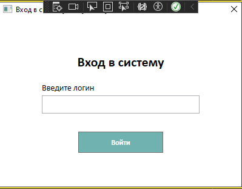

# **ЧУДО-ОБУВЬ**

### **[Скачать приложение]()**

### **Элементы системы:**
1. [Скрипт для базы данных](https://github.com/Svetlana184/MiracleShoes/blob/main/%D0%B1%D0%B4/database_script.txt)
2. [Настольное приложение](https://github.com/Svetlana184/MiracleShoesV2)

#### **Торговая компания «Чудо Обувь» занимается продажей обуви и имеет сеть магазинов. Приложение для заказа обуви дает возможность клиентам компании выбрать и заказать одну или несколько пар обуви из каталога различных моделей и размеров обуви в торговом зале. На данный момент услуга предоставляется только для обуви, в дальнейшем возможно расширение ассортимента товаров за счет аксессуаров.**

### **Функциональные требования:**

1. В каталоге должно храниться актуальное доступное для заказа количество товарных позиций, то есть сочетаний модели и размера.
2. Для каждой модели в каталоге должно сохраняться изображение. 
3. Пользователь должен иметь возможность выбрать из каталога одну или несколько пар обуви доступного размера, модели.
4. В интерфейсе должен быть доступен просмотр списка заказов с отображением ключевой информации: дата заказа, ФИО клиента;
5. Должно быть реализовано управление заказами. 

Вход в систему следует производить только по логину, указанному в списке пользователей системы (в ресурсах). Пароль при этом вводить не требуется.
После успешной авторизации пользователь получает доступ к соответствующим функциям системы.

### **В данной области определены следующие основные составляющие:**

1. Пользователи системы: администратор, менеджер, авторизованный пользователь, неавторизованный пользователь.

2. Пользователь: логин, фамилия, имя, отчество.

3. Товары: категория, подкатегория, производство, наименование, изображение, состав, описание, размерный ряд, доступные для заказа размеры, количество, цена.

4. Товарная позиция: модель, размер.

5. Заказ: дата заказа, фамилия, имя, отчество клиента, товарная позиция, количество, цена за единицу товара, итоговая сумма по заказу.

### **Функционал, доступный пользователям:**

1. Неавторизованный пользователь должен иметь возможность просматривать каталог товаров (допустимо без фильтрации, сортировки, поиска).
   

  

3. Авторизованный пользователь должен иметь возможность просматривать каталог товаров (с фильтрацией, сортировкой и поиском), оформлять заказы: добавлять/удалять товарные позиции, изменять количество.

4. Менеджер должен иметь возможность просматривать каталог товаров (с фильтрацией, сортировкой, поиском), оформлять заказы (добавлять/удалять товарные позиции, изменять количество), просматривать заказы, состав конкретного заказа, добавлять новые заказы и удалять существующие.

5. Администратор должен иметь возможность просматривать каталог товаров (с фильтрацией, сортировкой, поиском), оформлять заказы (добавлять/удалять товарные позиции, изменять количество), просматривать заказы, состав конкретного заказа, добавлять новые заказы и удалять существующие. Администратор должен иметь возможность редактировать заказ.

Взаиморасчеты торговой компании с клиентами осуществляются в рублях.

## **Инструкция по установке**

## **Работа с приложением**

Приложение, как описано в требованиях по функционалу, разделяетр функционал на четыре роли: неавторизованного пользователя, авторизованного пользователя, менеджера и администратора.
Приложение имеет экран входа и основной экран, в котором есть две вкладки - каталог и список заказов.

### **Начальный экран**

При первоначальном открытии приложения пользователем появляется каталог товаров для неавторизованного пользователя. Пользователь может просматривать товары без возможности поиска и сортировки. 
В левой части окна находятся кнокпи для переключения между экранами. Нажав на кнопку "Войти" пользователь попадает на экран входа в приложение.

### **Экран входа**

В окне входа пользователь вводит свой логин и авторизуется.

### **Каталог для авторизованного пользователя**

Если пользователь не имеет роли администратора или менеджера, он получает возможность сортировки и поиска товаров.

### **Заказы пользователя**

Пользователь может оформлять свои заказы.

### **Каталог для администратора**

Администратор также может просматривать каталог товаров с сортировкой и поиском.

### **Заказы для администратора**

Администратор оформляет заказы, просматривает заказы, состав конкретного заказа, добавляет новые заказы и удаляет существующие. Администратор имеет возможность редактировать заказ.

### **Каталог для менеджера**

Менеджер в каталоге имеет аналогичные администратору возможности.

### **Заказы для менеджера**

Во вкладке "Заказы" менеджер может оформлять заказы, просматривать заказы и их составы.

## **Техническая часть**

База данных спроектирована в СУБД DBeaver на PostgreSQL и приведена к третьей нормальной форме.

Настольное приложение реализовано в среде Microsoft Visual Studio на WPF с помощью языка C#. Приложение следует паттерну MVVM.
